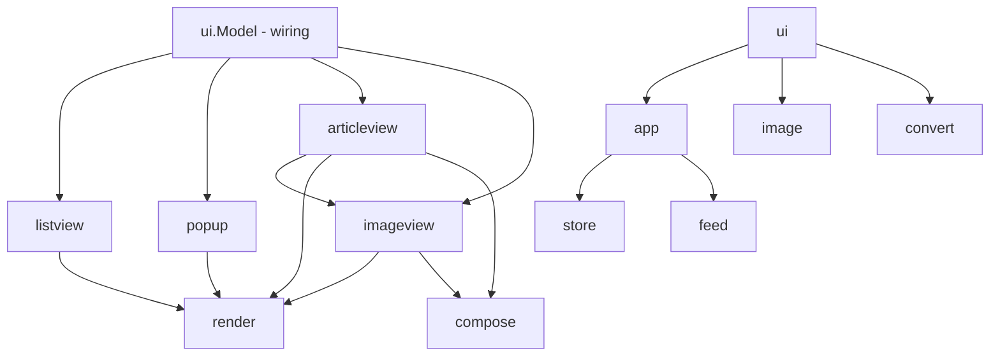

## Context

See proposal.md — Why. The repo is a bubbletea/lipgloss Go terminal RSS reader. `internal/ui` is a ~34-file package centered on a god object `*Model`; `internal/app.Session` is a thin facade over `internal/store`; `render/` and `compose/` are already pure, well-tested sub-packages that establish the house style. Five pure-refactor proposals (all `skip_specs: true`) are staged to converge on the target architecture below. This document is the durable record of that target and the order to reach it.

## Goals / Non-Goals

**Goals:**

- Give a single, accurate picture of the target architecture the five refactors converge on.
- Fix the execution order and justify it (low-risk first, the big move last).
- Provide a copy-paste handoff prompt a build agent can follow without re-deriving the plan.

**Non-Goals:**

- No new implementation beyond what the five refactors already specify. This document is the deliverable.
- No new spec capabilities — behavior is unchanged end-to-end (hence `skip_specs`).
- No re-derivation of each change's internal details; those live in the individual `design.md`/`tasks.md`.

## Target architecture

### `internal/ui` — a wiring layer, not a god object

After all five refactors, `internal/ui` shrinks to `model.go` plus the message routing in `Update`. `Model` keeps only cross-cutting state (session handle, dimensions, palette, styles, view/popup routing) and delegates rendering and input to four view sub-packages:

- `internal/ui/listview` — `State` (today `listState`) + list rendering and list input (`list.go`, `list_update.go`).
- `internal/ui/popup` — `State` (today `popupState`) + tag/links/help popups (`popup.go`, `popup_help.go`).
- `internal/ui/imageview` — `View` (the `imageView` from `extract-image-view-state`) + image rendering/scheduling (`image.go`).
- `internal/ui/articleview` — `State` (today `articleState`) + composition, article rendering, and selection (`article.go`, `article_update.go`, `article_selection.go`).

`render/` and `compose/` absorb the remaining pure helpers (`overlay`, `spliceStyled`, `formatMB`, `railGlyph`, day-header/status-bar builders).

**Dependency direction:** views may import `render`/`compose` and shared packages; `articleview` may import `imageview`; **nothing imports `Model`**. `Model` is the composition root that constructs the views and passes them state; views return signals/updated state rather than reaching back into `Model`. The interim `imageView.m *Model` back-reference introduced by `extract-image-view-state` is replaced here by explicit parameters and return signals.

### `internal/app.Session` — the orchestration owner

`Session` grows from a thin facade into the orchestration owner for the feed pipeline:

- `Refresh() (*feed.FetchResult, error)` — wraps `feed.LoadFeeds` + `FetchFeeds`.
- `NeedsStartupRefresh(last, now time.Time) bool` — unfetched-feeds check + startup gate.
- `ManualRefreshAllowed(last, now time.Time) (bool, time.Duration)` — manual gate.

Gate methods take `last time.Time` from the caller to preserve the in-memory `lastRefreshedAt` semantics (set from the store at `Init`, updated on refresh). `feed.FetchResult`/`feed.FeedOutcome` remain as result passthrough types, not orchestration. Read-state policy (mark-read on open/scroll) stays in the view.

### `internal/ui/compose` — pure, link-agnostic helpers

`extract-link-anchor-helpers` moves `anchorableLine`, `stripLeadingURLTokens`, `isURLToken`, `findAnchorLine`, `commonPrefix`, `minURLFragmentLen` into `compose/anchor.go`, changing the link-aware helpers from `[]articleLink` to `[]string` (urls). The UI keeps a thin `urlsOf([]articleLink) []string` adapter.

### Dependency graph



## Correctness invariants (must hold at every step)

- Decode once per image per session (shared decoded-image cache across halfblock and native paths).
- Fire image work proportional to what is visible, with a bounded in-flight count (never to article length).
- A recompose after an image-load message inserts cached blocks and nothing else.
- Kitty native photos re-shown by placement reference after first transmit; OSC 1337 images re-emit per frame by necessity.
- Snap guards never return the pre-move offset (a bounce re-fires identically and loops); exactly one clear per no-native transition.
- Assert complexity bounds (at most 3N renders), never exact counts.
- Unicode/ASCII glyph pairs stay in sync (`glyphsFor` in `border.go`).

## Decisions

**D1. Order the refactors C → A → B → D → E, low-risk first, then the big one.**

The five changes form a dependency ladder, not five independent jobs:

1. `extract-link-anchor-helpers` (C) — pure helper move, zero structural risk. Warm-up that also shrinks `image.go` before the big move.
2. `extract-image-view-state` (A) — the big one. Carves the image concern into an `imageView` value with a `*Model` back-reference. This is the enabling step for the package split; it must precede B.
3. `split-ui-package` (B) — splits `internal/ui` into `listview`, `popup`, `imageview`, `articleview`. Replaces `imageView`'s `*Model` back-reference with explicit parameters (possible only because A already isolated the type).
4. `complete-session-migration` (D) — moves feed orchestration into `Session`. Orthogonal to the UI split; safe to do after B.
5. `consolidate-lipgloss-version` (E) — dependency cleanup; independent of everything, but scheduled last because a `go mod tidy` at the end sweeps away any transitional v1 imports the earlier moves leave behind.

Rationale for last-vs-first: C is self-contained and low-risk, so it goes first to establish momentum and prove the workflow. A is the structural lynchpin — nothing downstream can proceed without it, and it is the highest-risk single edit, so it sits behind the warm-up. D and E are independent and can be reordered if desired; they are last because they touch the widest surface (D) or the dependency graph (E).

**D2. Put the target architecture in the roadmap's design.md, not in a spec.**

The target is an implementation concern (package layout, dependency direction), not a behavioral requirement. `skip_specs` is correct; the architecture lives here and is archived with the change so it survives after the individual proposals are archived.

**D3. The handoff prompt references the change directories by name.**

The build agent is pointed at `openspec/changes/<name>/tasks.md` for each step in order, and told to run `/opsx-apply` per change and to respect the AGENTS.md invariants, rather than carrying the full task detail inline.

## Risks / Trade-offs

- **[Five changes are staged but unstarted] →** Mitigation: the ordering section is the single source of truth; a build agent follows it in order and stops on any failed `go test` at a change boundary.
- **[The `*Model` back-reference in A is an interim smell] →** Acceptable and deliberate: it is replaced by explicit parameters in B (step 3). Documented in A's design so no one mistakes it for the end state.
- **[D and E touch wide surfaces last] →** Mitigation: each is orthogonal (D = orchestration, E = dependency graph), so either can be dropped or deferred without invalidating C→A→B.
- **[Ordering drifts from what a future maintainer prefers] →** Acceptable: D and E are explicitly swappable; only C→A→B is a hard ordering.

## Build-agent handoff prompt

Copy the block below verbatim into a fresh build-agent session:

```text
You are implementing a pre-planned refactor sequence in /Users/jones/src/github/yerss,
a Go terminal RSS reader. Read AGENTS.md first and follow its OpenSpec workflow and
commit-message rules.

There are five changes in this sequence. Implement them in this exact order, one at a
time:

1. extract-link-anchor-helpers
2. extract-image-view-state
3. split-ui-package
4. complete-session-migration
5. consolidate-lipgloss-version (already complete and archived — skip)

For each change that has not yet been implemented: read openspec/changes/<name>/proposal.md,
design.md, and tasks.md, then run /opsx-apply to implement its tasks, updating task
checkboxes in real time. Do not proceed to the next change until the current one's tasks
are all complete and `go build ./...` and `go test ./...` pass. Do not archive a change
unless explicitly asked; the user will archive them.

Invariants to preserve while editing the image path (from AGENTS.md):
- decode once per image per session (shared decoded-image cache)
- fire image work proportional to visible images, bounded in-flight
- a recompose after an image-load message inserts cached blocks only
- kitty native photos re-shown by placement reference after first transmit
- snap guards never return the pre-move offset; exactly one clear per no-native transition
- assert complexity bounds (at most 3N renders), never exact counts
- keep Unicode/ASCII glyph pairs in sync in glyphsFor

When done, report which changes are complete and which remain, and confirm the full
`go build ./... && go test ./...` pass.
```

## Progress checkpoint

This section is the durable resume point for the refactor ladder. Update it in place
as each change completes; do not rewrite the plan above.

| # | Change | Status |
|---|--------|--------|
| C | `extract-link-anchor-helpers` | **Done** |
| A | `extract-image-view-state` | **Done** |
| B | `split-ui-package` | Not started — **next** |
| D | `complete-session-migration` | Not started |
| E | `consolidate-lipgloss-version` | **Done** (archived 2026-09-14) |

### C — extract-link-anchor-helpers (done)

- `compose/anchor.go` holds the exported `AnchorableLine`/`FindAnchorLine` plus the
  unexported helpers; signatures take `[]string` urls. UI keeps `urlsOf` in
  `article.go`. Verified: `go build ./...` clean, `go test ./...` = 644 passed.

### A — extract-image-view-state (done)

- `internal/ui/image.go` now defines `type imageView struct` with the nine fields
  (`loading`, `frontier`, `nativePending`, `sem`, `previewCache`, `nativeSent`,
  `nativeSentPrev`, `nativeClearPrefix`, `nativeClearArticleID`) and a `m *Model`
  back-reference; all 30 image methods moved onto `*imageView` (the moved
  `nativeSentEqual` became a method).
- `Model` gained one field, `images imageView`, initialized in `New`; the nine
  fields were removed from `Model`.
- Only two `Model` methods remain in `image.go`, both thin delegates: the required
  `recomputeNativeClear` (preserves `Update`'s `defer` contract) and `flushRecompose`
  (preserves `Update`'s per-message flush call).
- `Update` routes the four `image.*Msg` cases through `m.images.on*` and flushes via
  `m.flushRecompose`; `View` reads `m.images.nativeClearPrefix`.
- External call sites updated to `m.images.*` in `article.go`, `article_update.go`,
  `selection.go`, and the three image test files. Behavior unchanged.
- Verified: `go build ./...` clean; `go test ./...` = 644 passed in 12 packages;
  the bound/cache suites (`TestRecomposeServesCachedBlocksRendersBounded`,
  `TestFrameCacheByteIdenticalWithNativeSelectionLinkMode`,
  `TestFrameCacheRecomposesOnImageLoadAtBoundary`,
  `TestFrameCacheSkipsNoOpBoundaryScrolls`) pass. Task 6.2's manual render-count
  check is covered by the automated bound test, which reproduces the photo-heavy
  case and asserts the ≤3N synchronous-render bound.

### Resume

Start a fresh agent session and re-issue the handoff prompt above (or `/opsx-apply`
on `split-ui-package`). The next change is **B, `split-ui-package`**: split
`internal/ui` into `listview`/`popup`/`imageview`/`articleview` and replace
`imageView.m *Model` with explicit parameters. If a fresh session is not possible,
keep going (HAM).
